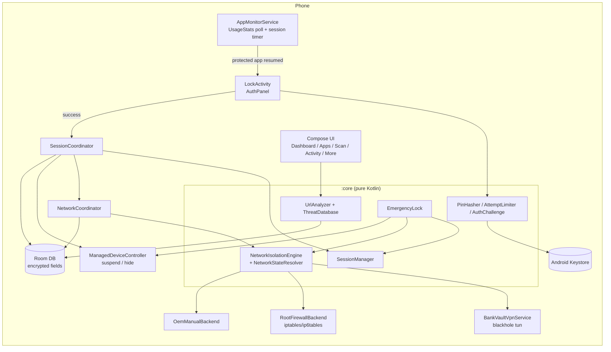
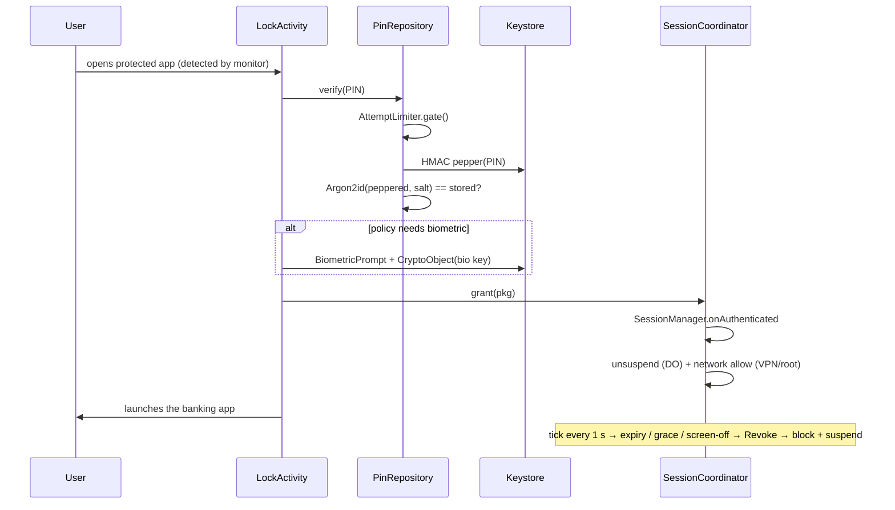
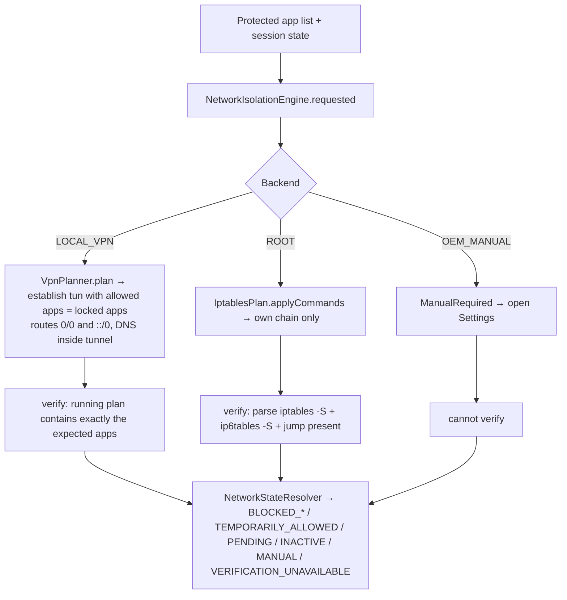
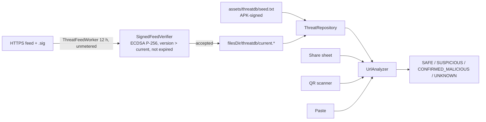

# BANKVAULT – Architecture

## Modules

The specification lists 21 logical modules. They are implemented as **3 Gradle modules** with one package per
logical module, so platform-independent security logic is isolated and testable on a plain JVM.

| Gradle module | Purpose |
|---|---|
| `:core` | Pure Kotlin/JVM. No Android imports. All security decisions live here and are unit-tested. |
| `:app` | Android app: platform adapters, services, Compose UI. |
| `:testbank` | Dummy "bank" used only for acceptance tests (network probes). |

| Logical module (spec §18) | Location |
|---|---|
| app-core | `app/…/AppGraph.kt`, `BankVaultApp.kt` (manual DI) |
| authentication | `core/auth/*` · `app/security/*` · `app/lock/AuthPanel.kt`, `Biometric.kt` |
| banking-protection | `app/apps/InstalledApps.kt`, `app/ui/AppsScreen.kt` |
| application-monitor | `app/monitor/AppMonitorService.kt` |
| network-isolation | `core/network/*` · `app/network/NetworkCoordinator.kt` |
| native-network-integration | `app/network/OemManualBackend.kt` |
| root-firewall | `core/root/IptablesPlan.kt` · `app/root/*` |
| optional-vpn-firewall | `core/vpn/VpnPlan.kt` · `app/vpn/*` |
| stealth-management | `app/stealth/StealthManager.kt`, `app/managed/*` |
| cyber-threat-intelligence | `core/threat/ThreatDatabase.kt` · `app/threat/*` |
| dns-security | `app/dns/PrivateDnsInspector.kt` |
| phishing-protection / safe-browsing | `core/threat/UrlAnalyzer.kt`, `Homograph.kt`, `UrlNormalizer.kt` · `app/ui/ScanScreen.kt` |
| privacy-protection | Private DNS tracker filtering + domain rules (`domain_rules` table) |
| session-manager | `core/session/SessionManager.kt` · `app/session/SessionCoordinator.kt` |
| anti-tampering | `app/tamper/TamperMonitor.kt` |
| security-monitoring / audit-logging | `core/audit/Audit.kt` · `app/data/AuditLogger.kt` |
| emergency-lock | `core/emergency/EmergencyLock.kt` · `app/emergency/*` |
| recovery-manager | `app/ui/MoreScreen.kt` (RecoverySection), `ForgotPinScreen.kt`, `ManagedDeviceController.relinquish` |
| ui-dashboard | `app/ui/*` |
| device compatibility | `core/compat/Compatibility.kt` · `app/compat/DeviceProfiler.kt` |

## System overview



## Authentication flow



## Network restriction flow



Rule: the state shown is computed from what the backend **read back**, never from what was requested.

## Application hiding flow

* **Device Owner / Profile Owner:** lock → `setPackagesSuspended(true)` + `setApplicationHidden(true)`; session grant → reverse;
  verified with `isPackageSuspended` / `isApplicationHidden`.
* **Unmanaged Realme/ColorOS:** owner uses *Hide apps*; BANKVAULT shows guided steps; status `MANUAL_SETUP_REQUIRED`.
* **BANKVAULT's own icon:** activity-alias disabled; refused unless the Quick Settings tile (recovery path) is added.

## Threat intelligence flow



## Recovery flow

```mermaid
flowchart TD
  A[Forgot BANKVAULT PIN] --> B[Recovery PIN on unlock screen] --> C[Set new PIN]
  D[Need banking app now / BANKVAULT broken] --> E[More → Recovery → recovery PIN → Release everything]
  E --> F[unsuspend + unhide, rollback iptables, stop VPN, show icon]
  G[BANKVAULT unavailable] --> H[Android Settings → Apps → BANKVAULT → Force stop / Uninstall]
  H --> I[VPN gone immediately; root rules gone after reboot or 'Release everything']
  J[Device Owner and app broken] --> K[adb: dpm remove-active-admin (debug builds) or factory reset]
```

## Database schema (Room, version 1)

| Table | Columns | Notes |
|---|---|---|
| `protected_apps` | packageName PK, label, blockWifi, blockMobile, sessionDurationMs, backgroundGraceMs, authPolicy?, hideWhenLocked, addedAt | No secrets |
| `audit_log` | id PK, type, timestamp, packageName?, detailEnc BLOB | detail redacted by `AuditRedactor`, then AES-GCM (Keystore) |
| `scan_history` | id PK, timestamp, sanitizedUrl, verdict, categories | URL without query/fragment only |
| `domain_rules` | domain PK, action (ALLOW/BLOCK), scope (THREAT/PRIVACY), addedAt | Owner's lists |

Secrets (PIN verifiers, attempt counters, settings) are in `SecurePrefs` (AES-GCM, Keystore key). Backups and device
transfer are disabled (`data_extraction_rules.xml`). Migrations must be explicit; destructive fallback is intentionally not
enabled because it would silently unprotect apps.

## Key decisions

* **No AccessibilityService.** It would improve launch interception but conflicts with the privacy requirements and Play policy.
* **No traffic forwarding in the VPN.** A blackhole VPN needs no packet parsing, no server and cannot leak data; the trade-off is
  that it cannot do DNS filtering for other apps at the same time – that is delegated to Private DNS.
* **Monotonic clock for sessions, persisted wall clock + rollback guard for lockouts.**
* **Manual DI (`AppGraph`)** instead of Hilt to keep the build simple; every class receives collaborators via its constructor.
